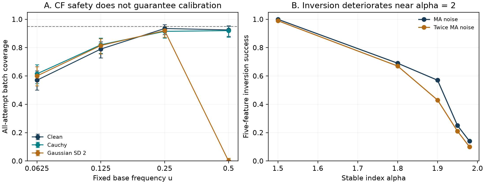

# Stable OU identification under unknown observation noise

Research materials for **Finite-Feature Identification of Stable Ornstein-Uhlenbeck Dynamics with Unknown Observation Noise**.

**Author:** ZHANG WENHAN  
Institute of Mathematical Sciences, Faculty of Science, Universiti Malaya, Malaysia  
**Contact:** 24084017@siswa.um.edu.my

## Download the complete research package

- [Version v0.15](https://github.com/vincent-zhang0116/stable-ou-identification/releases/tag/v0.15)
- [Complete code and data ZIP](https://github.com/vincent-zhang0116/stable-ou-identification/releases/download/v0.15/Stable_OU_v0.15_reproducibility.zip)
- [Current LaTeX manuscript](Stable_OU_v0.15.tex)
- [Literature comparison matrix](literature_matrix.csv)

The full executed source, data and verification files are inside the release archive. The repository file list displays the manuscript and summary artifacts. GitHub's automatic **Source code (zip)** download is not the full reproducibility package; use the named `Stable_OU_v0.15_reproducibility.zip` release asset.

## What the archive contains

- The original frozen experiment: 1,500 independent latent paths, 36,000 paired method/scenario records, feature/covariance outputs and 108 summary scenarios.
- Twelve selected complete raw paths with observation variants; the remaining paths are regenerable from recorded PCG64/SeedSequence inputs.
- An independent 700-path diagnostic study: paired frequency designs, a scalar moment comparator, and five-feature correlated-Gaussian noise diagnostics.
- Executable simulation and checking code, configurations, per-path outputs, checksums and reproduction instructions.

The full original study was rerun in a separate Windows environment. All point-status and coverage decisions matched. This was numerical reproduction, not byte-for-byte identity across environments. Adverse coverage and near-Gaussian inversion failures are retained. The research does not establish universally calibrated post-selection inference or settled priority over all closest predecessors.

## Reproduce

Download and extract the complete release ZIP, then open the extracted `Stable_OU_v0.15_public_release` directory. The revision ran with Python 3.13.16, NumPy 2.5.4 and SciPy 1.18.1.

```powershell
$env:OPENBLAS_NUM_THREADS='1'
$env:OMP_NUM_THREADS='1'
python -m pip install -r requirements_revision.txt
python verify_public_release.py
python revision_source/check_added_results.py
```

To rerun the original simulation into a separate output directory:

```powershell
python original_v013/source/experiment.py --config original_v013/config.json --out independent_rerun --workers 4
```

See the archive README for the new experiment, expected runtime, counting units, data dictionary and numerical-comparison limits. The LaTeX source is standalone and can be compiled with a standard LaTeX distribution. No newly exported PDF is included; use the current source.

## Diagnostics



## Declarations and citation

The author confirms no specific grant support and no competing interests. An AI assistant supported manuscript preparation, code development and mathematical/numerical checks. No code/data reuse license has been selected. No DOI has been assigned.

Suggested citation: ZHANG WENHAN. *Finite-Feature Identification of Stable Ornstein-Uhlenbeck Dynamics with Unknown Observation Noise*, v0.15. https://github.com/vincent-zhang0116/stable-ou-identification
